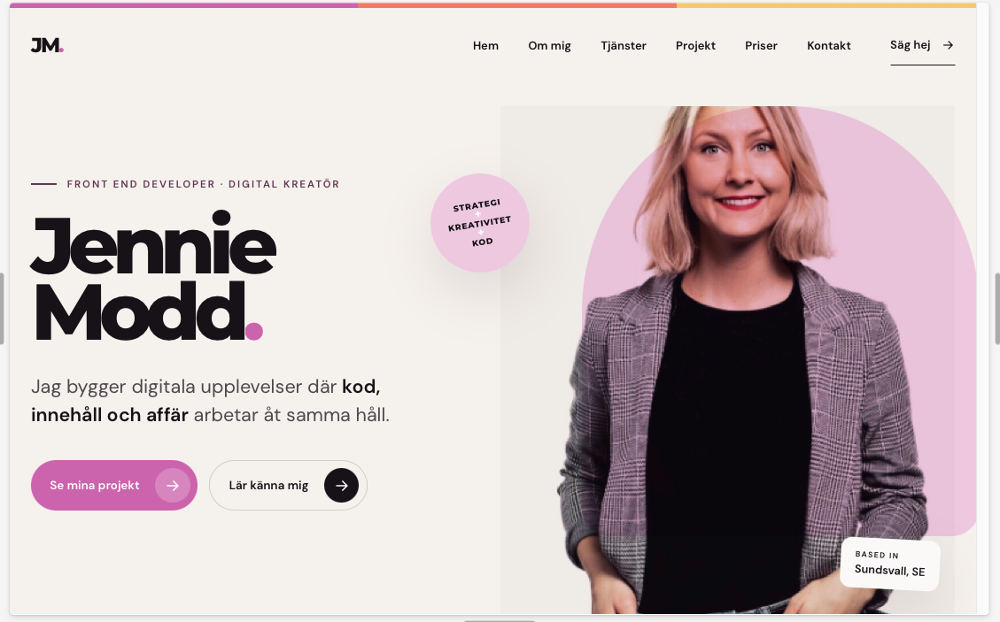
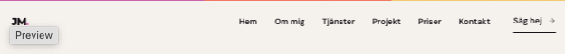
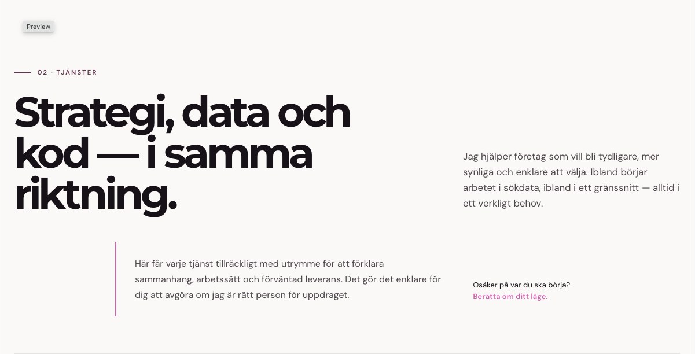
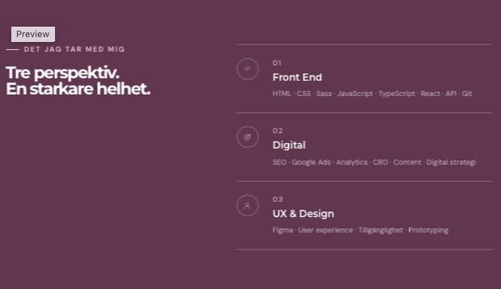
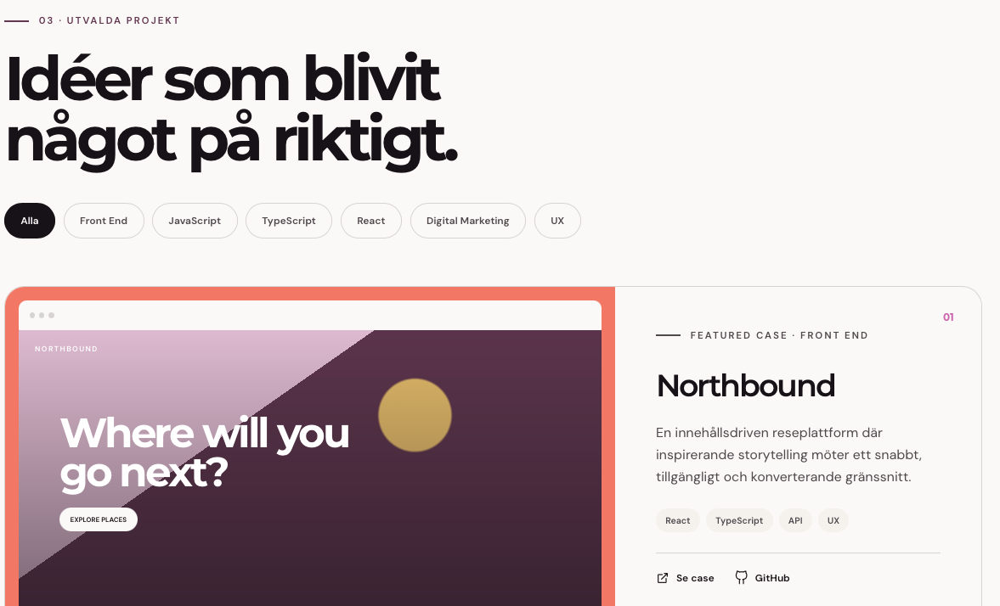
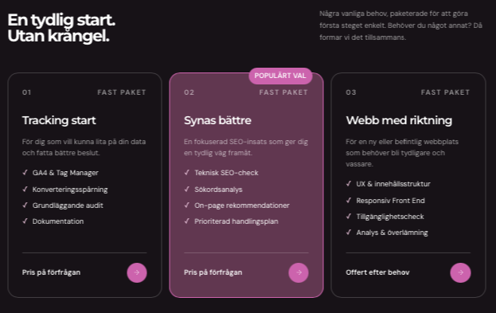
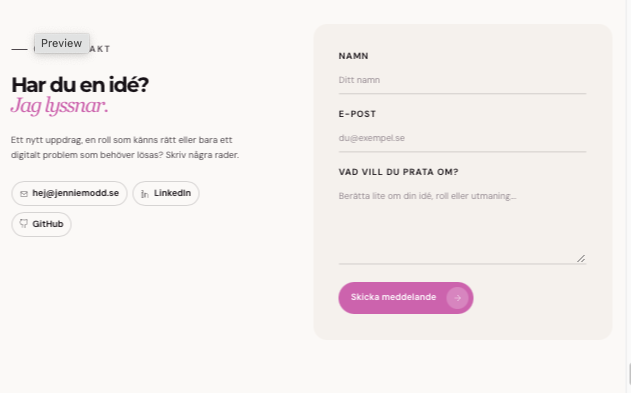

# Portfolio – Jennie Modd

En personlig portfolio som presenterar mina projekt, min erfarenhet och vad jag kan erbjuda inom digital marknadsföring och frontendutveckling.

Målet har varit att skapa mer än en traditionell portfolio. Jag ville bygga en webbplats som visar hur strategi, data, innehåll och kod kan samverka för att skapa tydliga och användarvänliga digitala upplevelser.

## Innehåll

- [Uppdrag och kravspecifikation](#uppdrag-och-kravspecifikation)
- [Design och Figma](#design-och-figma)
- [Vidareutveckling och egna initiativ](#vidareutveckling-och-egna-initiativ)
- [Arbete med AI](#arbete-med-ai)
- [Funktioner](#funktioner)
- [Tekniker](#tekniker)
- [Projektstruktur](#projektstruktur)
- [Komponentstruktur och datahantering](#komponentstruktur-och-datahantering)
- [Kontaktformulär](#kontaktformulär)
- [Kom igång](#kom-igång)
- [Reflektion](#reflektion)
- [Länkar](#länkar)


## Uppdrag och kravspecifikation

Projektet genomfördes som en skoluppgift på utbildningen Front End Developer vid Medieinstitutet. Uppdraget var att designa och utveckla en responsiv portfolio som en single-page application (SPA) med React och TypeScript. Arbetet skulle utgå från skisser i Figma för både desktop och mobil och använda Vite, återanvändbara komponenter, props och state.

Portfolion skulle innehålla minst sex projektkort, navigation mellan sektionerna Hem, Om mig, Projekt och Kontakt samt interaktivitet med `useState`, bland annat för projektfiltrering. Andra delar av uppgiften var responsiv design, animationer, versionshantering med Git och GitHub, driftsättning på Vercel samt en README med projektinformation och instruktioner.

Som tillval kunde projektet utökas med ett kontrollerat kontaktformulär med validering och felhantering samt filtrering där flera tekniktaggar kan väljas samtidigt.

## Design och Figma

Jag valde att testa Figma Make för att utforska nya designidéer utifrån min befintliga portfolio, som jag har arbetat med under en längre tid. Det gav mig inspiration att utveckla den visuella identiteten med fler färger och uttryck, samtidigt som jag ville behålla grunden i min ursprungliga design.

För mig var det viktigt att designen skulle kännas personlig och representera mig, snarare än att upplevas som en generisk, AI-genererad portfolio. Figma Make gav mig en bra utgångspunkt, men resultatet behövde justeras manuellt för att motsvara min vision. Jag arbetade därför vidare med CSS och justerade bland annat färger och teckenstorlekar. Jag tog även bort knappar och andra designelement som kändes överflödiga och gjorde helheten rörig.

Den visuella identiteten bygger på stora typografiska uttryck, plommonlila och rosa nyanser, rundade former och tydliga CTA-knappar. Målet är att förmedla både kreativitet och teknisk kompetens utan att designen känns generisk.

Fokus har varit att skapa en sammanhängande design genom hela webbplatsen, med tydlig visuell hierarki, genomtänkta avstånd och en responsiv layout. Genom att kombinera inspiration från AI med egna designbeslut och manuella justeringar har jag kunnat vidareutveckla min befintliga portfolio och skapa ett uttryck som bättre speglar mig och mitt varumärke.

### Ursprunglig design i Figma

Skärmbilderna från den ursprungliga designen som jag tog fram genom Figma-Make. 
















## Vidareutveckling och egna initiativ

Utöver kravspecifikationen valde jag att utveckla en mer långsiktig och hållbar portfolio som på sikt ska kunna integreras med en headless WordPress-lösning. Målet var att skapa en flexibel grund som kan vidareutvecklas i takt med att mina kompetenser och behov växer.

Jag lade även till separata sektioner för tjänster och prispaket, med ambitionen att vidareutveckla dem till egna undersidor med relevant innehåll och SEO-anpassning.

Mitt mål var att skapa mer än en traditionell portfolio som presenterar min erfarenhet och mina projekt. Jag ville bygga en webbplats som också tydliggör vad jag kan erbjuda som Digital Marketing Specialist och, framöver, Front End Developer. På så sätt fungerar webbplatsen både som en presentation av min kompetens och som en grund för min framtida konsultverksamhet.

## Arbete med AI

Jag valde att använda ChatGPT som AI-assistent under arbetet. Jag har bland annat tagit hjälp med kod när jag inte fått något att fungera själv och använt verktyget som bollplank när jag fastnat eller velat stämma av om jag tänkt rätt. Jag har även fått hjälp med CSS när något inte fungerat som jag tänkt, och med hover-funktioner som jag fortfarande utvecklar.

När ChatGPT inte kunde hjälpa mig vidare har jag även använt Claude som stöd. Jag känner mig bekväm med att formulera prompts och att ifrågasätta förslag när lösningen inte stämmer med hur jag vill att koden ska byggas. Samtidigt är det här mitt första React-projekt, så jag är medveten om att det fortfarande finns mycket i koden som jag behöver lära mig mer om.

Jag har gått igenom och anpassat förslagen själv, bland annat genom att justera CSS, färger, avstånd och komponenternas innehåll för att få ett resultat som stämmer med min egen vision. Jag har också valt att främst använda ChatGPT som stöd och inte förlita mig för mycket på Claude eller andra AI-lösningar. Jag vill själv tänka kritiskt, förstå vad som fungerar och lära mig längs vägen, i stället för att bara implementera en lösning utan att förstå den.

## Funktioner

- Responsiv layout för olika skärmstorlekar.
- Navigation mellan webbplatsens sektioner.
- Projektkort med filtrering på teknik och kategori.
- Möjlighet att välja flera filter samtidigt.
- Separata sektioner för tjänster och prispaket.
- Kontaktformulär med kontrollerade fält, validering och felhantering.
- Bekräftelse när formuläret har skickats.
- Återanvändbara React-komponenter.
- Projekt-, tjänste- och paketdata separerade från presentationen.

## Tekniker

- **React** – komponentbaserad uppbyggnad av gränssnittet.
- **TypeScript** – typning av data och komponentlogik.
- **Vite** – utvecklingsmiljö och byggverktyg.
- **CSS Modules** – komponentnära styling.
- **CSS** – responsiv design och visuella effekter.
- **Git och GitHub** – versionshantering.
- **Vercel** – driftsättning.
- **Figma och Figma Make** – design och utforskning av visuella idéer.
- **Formspree** – hantering av kontaktformuläret.

## Projektstruktur

Nedan visas en förenklad struktur över de viktigaste delarna av projektet. I `components/` ligger komponenternas `.tsx`-filer och tillhörande CSS Modules tillsammans, i stället för i separata undermappar.

```text
src/
├── components/
│   ├── Navigation.tsx
│   ├── Navigation.module.css
│   ├── Hero.tsx
│   ├── Hero.module.css
│   ├── Projects.tsx
│   ├── Projects.module.css
│   └── ...
├── data/
│   ├── projects.ts
│   ├── packages.ts
│   └── services.ts
├── types/
│   ├── project.ts
│   └── package.ts
├── App.tsx
└── main.tsx

docs/
└── figma/
    └── ...
```

## Komponentstruktur och datahantering

Webbplatsen är uppbyggd av separata React-komponenter för att göra koden enklare att läsa, underhålla och vidareutveckla. Varje komponent ansvarar för en avgränsad del av gränssnittet, exempelvis navigation, projekt, tjänster, prispaket eller kontaktformulär.

Projekt-, tjänste- och paketdata ligger i separata filer under `data/`, åtskilda från presentationen. TypeScript-typerna ligger under `types/` och beskriver strukturen på datan, vilket gör det lättare att upptäcka fel under utvecklingen och att återanvända typer där de behövs.

Projektfiltreringen hanteras med Reacts `useState`. Det gör att användaren kan välja flera filter samtidigt och att projektlistan uppdateras utifrån de valda kategorierna.

## Kontaktformulär

Kontaktformuläret använder Formspree för att hantera inskickade meddelanden. Formuläret har kontrollerade fält och validering för att hjälpa användaren att fylla i uppgifterna korrekt. Felmeddelanden visas vid ogiltiga fält eller problem vid inskickning, och ett bekräftelsemeddelande visas när formuläret har skickats.

## Kom igång

### Förutsättningar

Du behöver ha Node.js och npm installerat.

### Installera och starta projektet

1. Klona repot:

   ```bash
   git clone <repository-url>
   ```

2. Gå till projektmappen:

   ```bash
   cd <project-folder>
   ```

3. Installera beroenden:

   ```bash
   npm install
   ```

4. Starta utvecklingsservern:

   ```bash
   npm run dev
   ```

5. Skapa en produktionsbuild:

   ```bash
   npm run build
   ```

Byt ut `<repository-url>` och `<project-folder>` mot projektets faktiska värden.

## Reflektion

Det här är mitt första React-projekt, vilket har varit superroligt. Jag trivs verkligen med *learn by doing* och har fått en bättre förståelse för hur komponenter hänger ihop. Jag tycker alltid att det är roligt att börja med ett projekt från grunden, eftersom grundstruktur, design och upplägg skapar helheten och underlättar arbetet framåt.

Under resans gång har jag lärt mig mycket och också blivit bättre på att ifrågasätta AI-assistentens förslag när något hamnar på fel ställe. Till exempel föreslog AI att arrayerna för projekt och tjänster skulle ligga direkt i TSX-filerna, men jag valde att lägga dem i `data/` i stället. Jag valde även att placera typen för paket i en egen fil under `types/`, eftersom jag tror att det blir enklare att underhålla och vidareutveckla strukturen framöver, inte minst om jag migrerar till headless WordPress.

En reflektion är att AI, när problem uppstår, ofta föreslår ganska komplicerade lösningar och felsökningssteg. Här har jag verkligen fått öva på mitt kritiska tänkande genom att stanna upp och fråga mig själv: Behöver det verkligen vara så här komplicerat? Kan problemet bero på något enklare? Borde koden egentligen ligga någon annanstans? Jag upplever att jag lär mig mycket av just den processen.

Jag har fortfarande mycket att lära mig om enskilda delar av koden, men när det gäller helhetsstruktur och förståelsen för ett större projekt känner jag mig ändå hyfsat trygg. Framför allt har jag fått en bättre förståelse för hur jag kan bygga vidare på ett projekt på ett genomtänkt sätt, samtidigt som jag fortsätter att lära mig längs vägen.

Jag har livesatt den i vercel, men även kopplat på en domän som jag köpt via Loopia. 

## Länkar

- **Liveversion:** [jenniemodd.se](https://jenniemodd.se)
- **GitHub:** [Lägg till länk till repository](https://github.com/jenniemodd/portfolio_2)